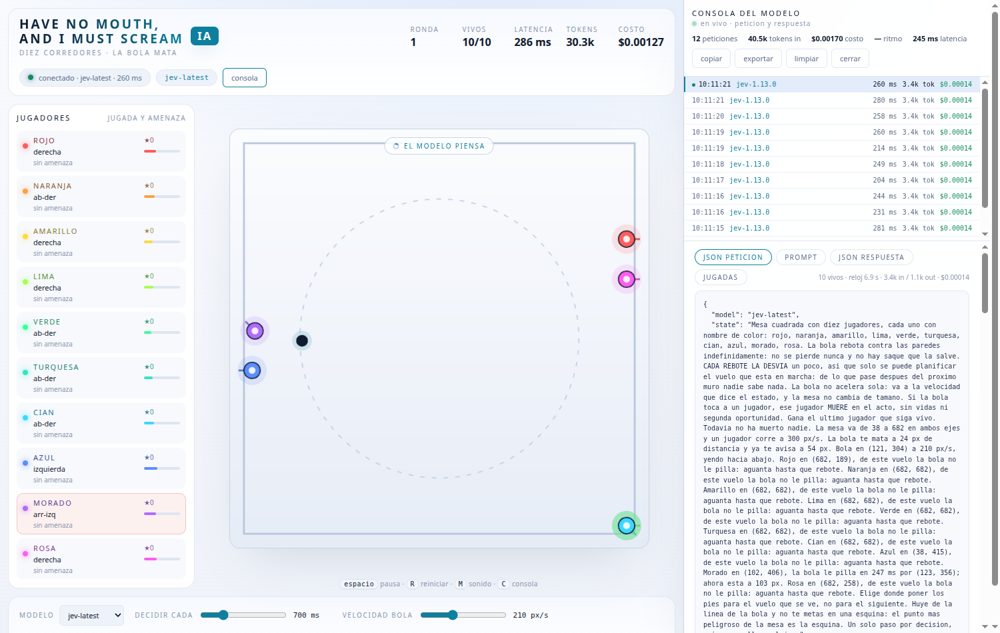

# Have No Mouth, and I Must Scream IA — Diez jugadores de colores (Next.js + TypeScript)

[](https://github.com/USUARIO/REPO/actions/workflows/ci.yml)
[](LICENSE)

Pong de diez jugadores con IA —rojo, naranja, amarillo, lima, verde, turquesa,
cian, azul, morado y rosa— en el que cada jugada la decide la API System One de
TypeSafe. Ya **no hay paddles ni vidas**: los diez son corredores que huyen
por toda la mesa, la bola rebota contra las paredes indefinidamente y **un solo
roce mata**. Y hay una segunda forma de morir: la mesa esta partida en una
**grilla invisible** y **cuatro o más apiñados en la misma celda, sostenido,
mueren todos**. Pero el objetivo ya no es sobrevivir solo: **si la ronda aguanta
un minuto con alguien vivo, reviven los muertos y ganan los diez**. Gana el
último que siga vivo, gana la mesa entera si aguanta el minuto, o no gana nadie
si la grilla se los lleva a todos. Y para compensar la tregua, la bola puede ir
al **doble** de rápido.



La regla de muerte viaja en cada prompt: todos los jugadores reciben, en cada
decisión, dónde está la bola, en cuántos milisegundos les pilla y por dónde, y
quién ya no está en juego.

Es la version "de verdad" del prototipo de un solo archivo: mismo juego, misma
estetica, pero con motor, red y UI separados y tipados de punta a punta.

El concepto original quedo guardado sin tocar en `legacy/concept.html` para
poder comparar. Aquel prototipo ya dibujaba con Phaser 3 en un solo archivo; la
version de verdad recupera el motor grafico, ahora separado del motor de juego.

## Arrancar

Requiere Node 20.9 o superior (`nvm use` respeta el `.nvmrc`).

```bash
npm install
cp .env.example .env.local   # pega tu TYPESAFE_API_KEY
docker compose up -d         # mongo :27017, express :8081 (opcional)
npm run dev                  # http://localhost:3000
```

El unico proveedor es **TypeSafe**: saca tu clave de
https://console.typesafe.ai/keys, pegala en `TYPESAFE_API_KEY` y listo. El
modelo por defecto es `jev-latest`; en el panel puedes cambiar entre los que
publique `GET /v1/models`.

Sin clave el servidor levanta igual, pero `POST /api/decision` responde 502 y no
hay jugadas: no hay modelo local ni respaldo heuristico al que caer. Si TypeSafe
falla, el panel lo avisa y los jugadores se quedan con su ultima orden hasta que
el modelo vuelva.

Scripts: `npm run dev`, `build`, `start`, `typecheck`, `lint`, `test`, y
`npm run verify` que corre los tres ultimos.

## Como esta organizado

La regla es simple: **el motor no sabe que existe un navegador, y el navegador
no sabe que existe un proveedor de modelo.**

| Capa | Carpeta | Que hace |
| --- | --- | --- |
| Fisica | `src/lib/game/world.ts` | La mesa sobre planck.js: la bola y las cuatro paredes. |
| Motor | `src/lib/game` | Reglas, jugadores, la grilla antiagolpamiento, muerte y saque. TypeScript puro, testeable. |
| Trayectoria | `src/lib/game/physics.ts` | Donde estara la bola, cuando pilla a cada uno y como se resuelve un roce. |
| Prompt | `src/lib/game/prompt.ts` | Convierte el estado en el texto en espanol + las preguntas. |
| IA | `src/lib/ai` | Contratos (zod) y normalizacion de la respuesta. |
| Servidor | `src/server/*`, `src/app/api/*` | Habla con TypeSafe. El navegador nunca lo hace. |
| Cliente | `src/lib/client` | Bucle de decisiones, stores y ajustes. |
| Instrumentacion | `src/server/trace.ts`, `src/lib/ai/pricing.ts` | Traza de peticiones y tarifas de TypeSafe. |
| Historico | `docker-compose.yml`, `src/server/mongo.ts`, `src/lib/client/match-recorder.ts` | MongoDB: cada partida completa en la coleccion `matches`. |
| Mesa | `src/lib/client/board` | La escena de Phaser 4: dibujo, particulas, tweens, camara y audio. |
| UI | `src/components`, `src/hooks` | HUD, consola del modelo y estados. React solo pinta; el juego corre fuera. |

### Cambios de fondo frente al prototipo

0. **Huir, no tapar.** No hay paddles ni vidas. Hay diez jugadores, cada uno con
   el nombre de su color, que se mueven libres por la mesa en ocho direcciones
   (más quedarse quieto) y su decisión es **una sola** por turno, no dos. Los
   diez salen de un mismo círculo alrededor del centro, así que ninguno arranca
   con ventaja. La bola es el peligro: no se pierde nunca, y un roce la mata.
   La partida acaba cuando queda un jugador, o antes si la grilla
   antiagolpamiento (ver el punto 13) vacía la mesa.
1. **La bola tuerce en cada rebote, y esto no es un detalle.** Con la dirección
   constante, una bola elástica recorre siempre las mismas cuatro rectas de la
   mesa: hay medio tablero donde **no puede aparecer nunca**, los jugadores se
   refugian ahí y la partida no acaba en la vida. Con un desvío pequeño y
   aleatorio en cada rebote el vuelo siguiente es impredecible, la mesa se va
   llenando y alguien tiene que morir. El coste es que solo se puede planificar
   el vuelo en marcha; el prompt lo dice y `predictThreat()` corta el horizonte
   en el próximo muro en vez de inventarse el futuro. La velocidad de la bola no
   la cambian ni los rebotes ni las muertes, y la mesa tampoco cambia de tamano;
   arranca **al máximo** (840 px/s, `BALL_SPEED = MAX_BALL_SPEED`) y lo unico que
   la mueve es el control "velocidad bola" del panel, que la puede bajar en vivo
   (90 a 840 px/s; el techo es el doble de la velocidad del corredor, así que de
   fábrica el juego es de pura tensión). No
   hay muerte subita, pero sí un reloj: si la ronda aguanta `SURVIVAL_MS` (un
   minuto) con alguien vivo, no gana uno — reviven los muertos y ganan todos
   (ver el punto 14).
2. **El roce se resuelve con un barrido, no con cuerpos de Box2D.** Los
   jugadores son círculos que viven en el motor, y el motor comprueba el
   segmento que la bola recorrió en el paso contra cada uno. Así no hay
   tunneling por rápido que vaya la bola, y —lo importante— la bola **no se
   desvía** al matar a alguien: su trayectoria no depende de los jugadores.
3. **La predicción es una fórmula cerrada, no una simulación.** Las cuatro
   paredes son ejes, así que cada eje se resuelve por separado y la posición
   futura de la bola sale de una reflexión exacta (`ballAt`). Contra el vuelo
   real hay menos de 6 px de deriva a los 2,4 s, y como la predicción se
   recalcula desde el estado real en cada decisión, esa deriva no se acumula
   (`tests/world.test.ts`).
4. **El navegador nunca ve la clave.** Todo pasa por `POST /api/decision`: la
   URL y la `TYPESAFE_API_KEY` viven en el servidor, que valida y normaliza la
   respuesta antes de que llegue al juego. El prompt viaja como `state` y las
   jugadas como `questions` tipadas, el contrato System One de TypeSafe.
5. **Motor separado del render.** `GameEngine` avanza con `step(dtMs)` y devuelve
   eventos; quien dibuja solo dibuja (hoy la escena de Phaser, antes un canvas
   propio). Se puede testear el juego sin navegador ni red.
6. **La fisica no es casera.** Corre sobre [planck.js](https://piqnt.com/planck.js/)
   (el port de Box2D a TypeScript): deteccion continua de colisiones (`bullet`),
   paso fijo de 1/60 y contactos reales. Eso compra dos cosas:
   - **La trayectoria no depende del frame.** A 8 ms o a 25 ms por frame el
     resultado es el mismo (`tests/engine.test.ts`); antes, un frame lento
     cambiaba el punto de rebote.
   - **La bola no atraviesa una pared** ni a 80 m/s. El centre de Box2D es de
     100 px por metro y hay que bajar `Settings.velocityThreshold` porque la
     bola es lenta (2,1 m/s) y con el valor por defecto los rebotes suaves no
     ocurren.
7. **Respuestas validadas.** El modelo contesta texto libre; zod y
   `normalizeDecision()` lo convierten en una jugada concreta con probabilidades
   saneadas. Si la respuesta viene rara, el juego no se rompe.
8. **Un solo proveedor, sin respaldo.** No hay modelos locales ni controlador
   heuristico: cada jugada la decide TypeSafe y nada mas. Si TypeSafe no
   responde, el panel lo marca como error y la ronda espera a que vuelva: no hay
   decisiones que no vengan del modelo que elegiste.
9. **React no corre a 60 fps.** Quien avanza el motor y dibuja es la escena de
   Phaser, con su propio bucle; React solo se vuelve a renderizar cuando cambia
   algo de verdad (`useSyncExternalStore` sobre el motor).
10. **Phaser 4 dentro, pero de un solo lado.** Phaser es la capa de
    presentacion: escena, sprites, particulas, tweens, camara, input y audio.
    El motor (`src/lib/game`) no sabe que Phaser existe, asi que las reglas, la
    trayectoria y los tests siguen corriendo en Node sin navegador. La fisica no
    pasa por Arcade ni por Matter: la mesa ya corre sobre Box2D (planck) y la
    prediccion que alimenta al LLM es analitica; cederla a un motor de pasos
    perderia esa exactitud. El punto de corte es `src/lib/client/board/board.ts`.
11. **La mesa usa el ancho disponible.** El motor sigue pensando en 720x720; el
    `ScaleManager` de Phaser (`FIT` + `CENTER_BOTH`) estira el canvas dentro de
    su caja cuadrada sin tocar la simulacion. El ancho de la mesa se corta
    siempre contra la altura de la ventana para que la cancha nunca se salga de
    cuadro; cuando ademas sobra ancho, el panel se pone al lado y no hay que
    hacer scroll.
12. **La hidratacion no depende del azar.** El motor sortea el saque con
    `Math.random`, asi que su estado inicial no es el mismo en el servidor y en
    el navegador. `useEngineUi` pinta el HTML del servidor con un snapshot
    estable y pasa al estado vivo en cuanto React hidrata; sin eso React
    descartaba la hidratacion (error #418).
13. **La grilla antiagolpamiento.** Además de la bola hay una segunda regla de
    muerte, y no es decorativa: la mesa se parte en una grilla de 16x16 celdas
    de 42 px (lo justo para un cuerpo, `GRID_CELL`) y una celda que reúne a
    **más de tres** corredores vivos y lo sostiene `CROWD_STRIKES` revisiones
    seguidas (una cada `CROWD_CHECK_MS`) revienta y mata a todos los que están
    dentro. La aglomeración tiene que persistir: un cruce de paso no cuenta. Es
    el castigo a acampar en una puntica, el comportamiento que hacía que la
    partida se resolviera escondiéndose. La regla viaja en el prompt —con la
    celda de cada jugador, cuántos la comparten y la **posición relativa de cada
    uno frente a los demás vivos**, dirección y distancia, del más cercano al
    más lejano— y se dibuja tenue en la mesa;
    la celda en peligro se enciende en rojo. Si la grilla se lleva a todos, la
    ronda termina **sin ganador** (`UiState.draw`, cartel "LA GRILLA SE LOS
    LLEVO") en vez de quedarse girando sin jugadores.
14. **La meta colectiva: aguantar un minuto hace ganar a todos.** El objetivo
    dejó de ser individual. Si la ronda llega a `SURVIVAL_MS` (60 s) con al
    menos un jugador vivo, **reviven los muertos** —vuelven al punto donde
    cayeron— y la ronda es de los diez: `UiState.truce`, cartel "SOBREVIVEN
    TODOS", y el marcador suma una victoria a cada color. El reloj es de ronda
    y no lo reinicia ninguna muerte: solo sirve la supervivencia sostenida. Es
    el cierre opuesto a la grilla (contra apiñarse, contra morir solo) y la
    razón de que el techo de la bola haya subido al doble: aguantar el minuto
    con la bola a 840 px/s es la hazaña. Como las rondas reales se resolvían en
    pocos segundos, la tregua es rara y por eso vale doble: no se gana
    sobreviviendo, se gana sobreviviendo **juntos**.
15. **El historico vive en Mongo, y solo guarda partidas completas.** Cada ronda
    que **aguanta el minuto** (la tregua) se guarda entera en **una sola
    coleccion**, `matches`: configuracion, desenlace, y encima la partida
    completa —un muestreo de la mesa cada 200 ms (bola y diez corredores con su
    celda), **cada decisión del modelo** con sus probabilidades, y **cada
    evento** (rebote, saque, muerte con causa, cierre). Cada documento lleva un
    `matchId` propio y su `at`, así que dos partidas nunca se confunden y el
    análisis posterior se hace filtrando la colección. También guarda, turno por
    turno, la **petición y la respuesta crudas de Jev** (`modelCalls`): el
    `state` que vio el modelo y el JSON que contestó, enlazados por `matchId`
    porque los arma el servidor y el navegador nunca los ve. Las rondas que terminan
    antes (gano uno, o la grilla vació la mesa) **no se guardan**: no son
    completas. El grabador (`src/lib/client/match-recorder.ts`) junta la
    telemetría en el navegador y el servidor la persiste; Mongo es opcional, sin
    `MONGO_URL` el juego no cambia.

### La mesa, archivo por archivo

| Archivo | Que hace |
| --- | --- |
| `src/lib/client/board/board.ts` | La escena: crea los objetos, avanza el motor en su `update`, reacciona a los eventos y sincroniza la mesa con `engine.view()`. |
| `src/lib/client/board/geometry.ts` | Geometria pura: el anillo discontinuo y el cono de direccion. |
| `src/lib/client/board/tone.ts` | Sintesis de los sonidos. |
| `src/components/Stage.tsx` | La caja donde Phaser inserta su canvas, mas los carteles que siguen en React (pensando, ganador). |

Phaser se carga con `await import('phaser')` dentro de un efecto, asi que nunca
entra en el render del servidor: es un chunk aparte de 1,4 MB (345 KB gzip) que
solo se pide cuando la pagina ya se monto. El motor no lo conoce, de modo que
los tests siguen corriendo en Node sin navegador.

Tres trampas que ya estan resueltas y conviene no reintroducir:

- **Hidratacion (#418).** El motor sortea el saque con `Math.random`; si React
  pintara su estado en el servidor, ese HTML no coincidiria con el del
  navegador. `useEngineUi` devuelve un snapshot estable para el servidor.
- **StrictMode.** En desarrollo React monta, desmonta y vuelve a montar: la
  escena se destruye en el cleanup y el montaje tardio se cancela, para no
  dejar dos canvas ni dos bucles.
- **Audio.** Los tonos se registran como `AudioBuffer` de forma sincrona.
  `sound.decodeAudio` se probo y revienta cuando el callback asincrono llega
  con el juego ya destruido.

## API

| Ruta | Metodo | Descripcion |
| --- | --- | --- |
| `/api/health` | GET | Configuracion efectiva de TypeSafe (sin la clave). |
| `/api/models` | GET | Modelos que publica TypeSafe. Nunca falla: informa `reachable` y `configured`. |
| `/api/decision` | POST | Recibe el snapshot del juego y devuelve la jugada de cada jugador. |
| `/api/trace` | GET, DELETE | Peticiones al modelo y resumen de la sesion (tokens y costo). `?limit=0` trae solo el resumen. |
| `/api/trace/stream` | GET | Server-Sent Events: empuja la traza en cuanto hay una peticion nueva. |
| `/api/matches` | POST | Guarda una partida completa (la que aguanto el minuto) en Mongo, con las peticiones y respuestas crudas de Jev. |
| `/api/matches` | GET | Ultimas partidas (resumen). `?limit=50` (tope 500). Con `?matchId=` devuelve una partida entera. |
| `/api/matches` | DELETE | Suelta las llamadas a Jev archivadas de una ronda que no se guardo. `?matchId=`. |

`POST /api/matches` recibe el documento de una ronda completa (`matchId`,
`config`, `result`, `samples`, `decisions`, `events`). El servidor le adjunta las
**peticiones y respuestas crudas de Jev** que archivo por `matchId` mientras se
jugaba. Responde `201 { stored: true, id, modelCalls }` si se guardo; `200
{ stored: false, reason }` si la partida no era completa o Mongo no estaba
configurado; `400` si no cumple el contrato.

`POST /api/decision` recibe `{ snapshot, model? }` y responde:

```json
{
  "model": "jev-latest",
  "latencyMs": 277,
  "players": {
    "rojo": {
      "choice": "arriba-derecha",
      "move": "arriba-derecha",
      "probabilities": {
        "arriba-izquierda": 0.04,
        "arriba": 0.07,
        "arriba-derecha": 0.62,
        "derecha": 0.11,
        "abajo-derecha": 0.05,
        "abajo": 0.03,
        "abajo-izquierda": 0.02,
        "izquierda": 0.04,
        "quedarse": 0.02
      },
      "confidence": 0.62
    },
    "verde": { "...": "las nueve direcciones valen igual para todos" },
    "azul": { "...": "..." },
    "amarillo": { "...": "..." }
  },
  "usage": { "inputTokens": 3504, "outputTokens": 1105 }
}
```

`players` solo trae los jugadores que seguian vivos cuando se hizo la pregunta;
el prompt lleva el estado de los diez y la regla de muerte.

`model` es opcional: si falta, se usa `TYPESAFE_MODEL`. Si TypeSafe falla, la
respuesta es un 502 con el codigo del fallo (`model-timeout`,
`model-unauthorized`, `model-malformed`...); no hay respaldo local.

## Historico de partidas (MongoDB)

El `docker-compose.yml` de la raiz levanta **MongoDB 7** y **mongo-express**
(para mirar la base desde el navegador):

```bash
docker compose up -d          # mongo :27017, express :8081
docker compose down           # apaga y conserva los datos
docker compose down -v        # apaga y borra el historico
```

Los puertos son variables para no chocar con otros stacks:
`MONGO_PORT=27018 MONGO_EXPRESS_PORT=8082 docker compose up -d`. La app se
conecta por `MONGO_URL`; sin esa variable el juego corre igual y no guarda nada.
La persistencia es **de mejor esfuerzo**: si Mongo no esta, la ronda siguiente
no se entera.

**Solo se guardan partidas completas.** Una partida completa es la que aguanta
el minuto entero (`SURVIVAL_MS`) con alguien vivo —la tregua colectiva—. Las que
terminan antes (un ganador, o la grilla vaciando la mesa) y lo que se abandona a
mitad se descartan. El filtro vive en `isCompleteMatch()` y se aplica en
`POST /api/matches`, asi que a la coleccion nunca llega una ronda a medias.

Todo cae en **una sola coleccion**, `matches`: un documento por partida. No es
un resumen; lleva la partida entera para el analisis posterior:

| Campo | Que trae |
| --- | --- |
| `matchId` | Identidad unica (`crypto.randomUUID`): la clave para diferenciar dos partidas. Indice unico. |
| `at` | Fecha del servidor. Indice descendente para ordenar el historico. |
| `round`, `model`, `outcome` | Ronda, modelo que decidia y desenlace (`truce` en toda partida guardada). |
| `config` | `intervalMs`, `ballSpeed`, `runnerSpeed`, radios y los parametros de la grilla y de la tregua: sin esto dos partidas no son comparables. |
| `result` | Duracion (`clockMs`), la meta del minuto (`survivalMs`), `reachedMinute`, decisiones, latencia media, rebotes, muertes (y cuantas por grilla) y los vivos al cerrar. |
| `samples` | La mesa cada 200 ms: bola y los diez corredores con su `cell` y `cellCount`. |
| `decisions` | Cada turno del modelo: `moves` y las `probabilities` por color. |
| `events` | Cada rebote, saque, muerte (con `cause`) y el cierre, fechados con el reloj de ronda. |
| `modelCalls` | **La peticion y la respuesta crudas de Jev**, una por turno: el `state` completo que recibio (con su `questions`) y el JSON exacto que devolvio, mas tokens, latencia y estado. |

Las llamadas crudas no viajan en el documento del navegador: las arma el
servidor. Cada `POST /api/decision` se etiqueta con el `matchId` de la ronda en
curso y el servidor la archiva (`src/server/model-calls.ts`), de modo que al
guardar la partida se adjuntan en orden. Si la ronda no llega al minuto, el
navegador las descarta (`DELETE /api/matches?matchId=`). El listado de `GET
/api/matches` viene sin series pesadas (ni `samples`, ni `modelCalls`): para eso
esta `?matchId=`, que trae la partida entera.

El mismo minuto que corre en la base se ve en pantalla: sobre la mesa hay un
**reloj de tregua** (`Stage.tsx`) que cuenta atras en `M:SS` con una barra, se
pone rojo en los ultimos 10 s, y desaparece en cuanto la ronda cierra. Su fuente
es el mismo `clockMs` del motor que alimenta `result.clockMs` y `samples[].clockMs`,
asi que lo que se ve y lo que se guarda son el mismo numero.

El muestreo lo junta el navegador (`src/lib/client/match-recorder.ts`, una foto
cada 200 ms —el mismo ritmo al que la grilla revisa las celdas—) y lo persiste
`src/server/mongo.ts`. Para analizar, basta filtrar la coleccion:

```js
// Las ultimas treguas del modelo jev-latest, con su duracion y muertes por grilla
db.matches.find(
  { model: 'jev-latest' },
  { matchId: 1, at: 1, 'result.clockMs': 1, 'result.crowdKills': 1, 'result.kills': 1 },
).sort({ at: -1 }).limit(50)
```

## Variables de entorno

| Variable | Default | Descripcion |
| --- | --- | --- |
| `TYPESAFE_API_KEY` | — | Clave de https://console.typesafe.ai/keys. Solo vive en el servidor. |
| `TYPESAFE_URL` | `https://api.typesafe.ai` | Endpoint de la API System One. |
| `TYPESAFE_MODEL` | `jev-latest` | Modelo por defecto de TypeSafe. |
| `TYPESAFE_TIMEOUT_MS` | `30000` | Corte por decision lenta. |
| `TRACE_BUFFER` | `200` | Cuantas peticiones guarda en memoria la consola del modelo. |
| `MONGO_URL` | — | MongoDB del historico. Vacia la persistencia queda apagada. |
| `MONGO_DB` | `nimble` | Base de datos donde vive la coleccion `matches`. |
| `LOG_LEVEL` | `info` | `debug`, `info`, `warn`, `error` o `silent`. |
| `LOG_PROMPTS` | `0` | `1` vuelca el prompt y las jugadas completas (nivel debug). |
| `NO_COLOR` | — | Cualquier valor apaga los colores de la terminal. |

## Logs

Todo lo que se imprime pasa por `src/server/log.ts`: una linea por evento, con
hora, nivel, alcance y campos `clave=valor` que se pueden filtrar con `grep`.

```text
07:31:02.418 INFO  [nimble:boot] Nimble Pong version=0.2.0 env=development node=v24.21.0
07:31:02.419 INFO  [nimble:boot] configuracion typesafe="https://api.typesafe.ai model=jev-latest timeoutMs=30000 key=ok" logLevel=info prompts=false
07:31:03.102 INFO  [nimble:typesafe] respuesta model=jev-latest ms=277 answers=10 inTokens=3504 outTokens=1105
07:31:03.104 INFO  [nimble:api/decision] decision model=jev-latest ms=277 alive=10 inTokens=3504 outTokens=1105
07:31:04.880 WARN  [nimble:typesafe] timeout model=jev-latest ms=30001 timeoutMs=30000
07:31:04.882 ERROR [nimble:api/decision] fallo del modelo code=model-timeout model=jev-latest ms=30002 error="ModelError: TypeSafe no respondio en 30000 ms"
```

`warn` y `error` van a `stderr` y el resto a `stdout`, asi que
`npm run dev 2>errores.log` separa lo importante. Con `LOG_LEVEL=debug` se
anaden la consulta enviada, los modelos disponibles, los errores con su pila
completa y el resumen de jugadas:

```text
07:34:09.448 DEBUG [nimble:api/decision] consulta al modelo model=jev-latest alive=10 clockMs=1000 ballSpeed=840 fieldMin=38
07:34:09.448 DEBUG [nimble:typesafe] consulta enviada model=jev-latest questions=10 stateChars=2056 timeoutMs=30000
07:34:13.883 DEBUG [nimble:api/decision] jugadas moves=rojo:quedarse,naranja:quedarse,amarillo:izquierda,lima:arriba,verde:izquierda
```

`LOG_PROMPTS=1` vuelca ademas el estado completo que recibe el modelo; esta
apagado por defecto para no inundar la terminal ni filtrar de mas.

## Consola del modelo y costos

Con `C` (o el boton "consola") se abre una **columna a la derecha** con todo lo
que salio hacia TypeSafe. No tapa la partida: el HUD y la mesa se encogen a su
lado (el panel de estadisticas cede su sitio, porque el resumen ya viaja dentro
de la consola). En pantallas estrechas, donde no caben dos columnas, vuelve a
ser un cajon inferior.

**Arranca abierta** y se actualiza en vivo por Server-Sent Events
(`/api/trace/stream`), no por sondeo: en cuanto hay una peticion nueva aparece
en la lista, y mientras no fijes una, la consola sigue la mas reciente.

- cada peticion con su hora, el modelo que respondio (`jev-latest` se resuelve a
  `jev-1.13.0`), latencia, tokens y costo;
- cuatro pestanas por peticion: **json peticion** (el cuerpo exacto que se mando:
  `model`, `state` y `questions`), **prompt** (ese mismo estado, legible),
  **json respuesta** (lo que devolvio TypeSafe tal cual, con `type`,
  `probabilities` y `usage`) y **jugadas** (la decision normalizada por jugador);
- botones para copiar lo que estas viendo, exportar toda la sesion a JSON y
  limpiar el buffer;
- el resumen de la sesion: peticiones, tokens de entrada, costo acumulado,
  costo por hora proyectado y latencia media.

El costo sale de la tabla oficial: Jev 1.13 cobra **$0,042 por millon de tokens
de entrada y los de salida son gratis**. Con el prompt actual —que además de la
amenaza y la celda lleva la **posición relativa de cada corredor frente a los
demás vivos**— la petición ronda los **4.800 tokens**, así que una jugada cuesta
~$0,00020 y una hora decidiendo cada 700 ms ronda los $1,05 (en las pruebas
reales la proyeccion salio entre $0,90 y $1,40 por hora). El precio
vive en `src/lib/ai/pricing.ts`: si TypeSafe cambia la tarifa, se cambia ahi y
el HUD y la consola quedan al dia solos.

La traza vive en memoria del servidor (no se escribe a disco) y se puede apagar
con el boton "traza" de la barra inferior: apagada, `POST /api/decision` no
guarda nada. El precio no se inventa: un modelo sin tarifa conocida se muestra
como "sin precio".

## Controles

`espacio` pausa · `R` reiniciar · `M` sonido · `C` consola del modelo ·
`esc` cierra la consola.

En la barra inferior, ademas del modelo y de cada cuanto decide, esta el
control **velocidad bola**: se arrastra y el cambio se aplica en el acto, sin
tocar la direccion que la bola llevaba. **Arranca al máximo** (840 px/s, el
doble de la velocidad del corredor) y solo se puede bajar; la velocidad se
guarda en `localStorage` y la respeta cada ronda nueva. Como viaja en el
snapshot, el modelo ve el cambio en la siguiente decision. El panel "en vivo"
lleva ademas una cuenta atras **para tregua** con lo que falta para el minuto,
y sobre la mesa esta el reloj grande.

Al lado esta el boton de tema: la app **arranca en modo claro** (es la que se
muestra en las demos) y el boton pasa a oscuro y lo recuerda. El tema cambia el
HUD y tambien el lienzo de Phaser: la mesa tiene su propia paleta clara, con un
aro oscuro en cada corredor para que los diez colores sigan leyendose.

No hace falta pulsar nada para jugar: al morir el penultimo jugador se canta
al ganador, el marcador de rondas ganadas se actualiza y, unos segundos
despues, la ronda siguiente arranca sola. La partida es un bucle mientras la
pestana siga abierta.

En el panel inferior puedes cambiar de modelo, ajustar cada cuanto se decide y
borrar la comparativa acumulada por modelo (se guarda en `localStorage`; lleva
el tiempo que su jugador sobrevivió en la mesa). El boton "borrar marcador" pone
a cero las rondas ganadas y el contador de rondas.

## Tests

```bash
npm test
```

111 pruebas sobre la fisica (rebote elastico, roce por barrido aunque la bola
vaya a 80 m/s, rebote suave contra la pared, deriva entre el vuelo real y el
previsto), la trayectoria (reflección exacta, límites, corte en el próximo
rebote, predicción de amenaza con bisección), el motor (muerte al primer roce,
velocidad y tamano de mesa estables durante toda la ronda, el control de
velocidad reescalando sin cambiar la direccion, desvio en cada pared,
ultimo en pie,
pausa, independencia del tamano del frame), la grilla (la celda de un punto y
el conteo por celda, tres apinados que no matan, cuatro que se sostienen y
mueren juntos, el apinon de paso que no cuenta, y la ronda sin ganador cuando la
celda vacia la mesa), la tregua (pasado el minuto con alguien vivo reviven los
caidos y la mesa entera gana), el prompt (la regla de muerte, la meta colectiva, la
amenaza de cada jugador y las nueve direcciones) y la normalizacion de las
respuestas. El contrato de partida y el grabador tienen su bloque: el documento
completo con sus diez jugadores por muestra, que `isCompleteMatch` solo acepta
la tregua, que el grabador junta muestras/decisiones/eventos y se reinicia
cuando el reloj retrocede (ronda nueva), y que la configuracion de Mongo no
filtra credenciales. El cliente de TypeSafe tiene el suyo: la cabecera
`Authorization`, el catalogo de `/v1/models` y el mapeo de errores (403 a
`model-unauthorized`, contrato roto a `model-malformed`). La traza y el precio
se prueban aparte: la aritmetica del costo por millon de tokens, el buffer
circular, el resumen de sesion, que un error no sume dolares y que el stream
reciba un aviso por cada peticion.

## Proximos pasos

- Mover el motor al servidor y sincronizar por WebSocket para partidas
  multijugador autoritativas.
- Panel del historico: leer la coleccion `matches` (`GET /api/matches` ya
  devuelve las ultimas) y comparar modelos y configuraciones en pantalla. El
  marcador de rondas y la comparativa por modelo siguen en `localStorage`.
- Variantes de prompt por modelo (`src/lib/game/prompt.ts` es el unico lugar a
  tocar).
- Modo espectador: varios modelos decidiendo a la vez sobre la misma mesa.
- **Calibrar la tregua.** Con TypeSafe respondiendo en ~250 ms y una decision
  cada 700 ms, las rondas se resuelven en pocos segundos y el minuto de
  `SURVIVAL_MS` casi nunca se cumple. Si se quiere que gane la mesa mas seguido,
  las palancas son `SURVIVAL_MS` (bajarlo) y el techo de la bola
  (`MAX_BALL_SPEED`, subirlo hace la tregua mas dificil); el ritmo de las
  decisiones lo mueve `DEFAULT_INTERVAL_MS`.
- Revivir jugadores o dar una segunda oportunidad fuera de la tregua: hoy la
  muerte es definitiva y solo se vuelve con el minuto aguantado o con la ronda
  siguiente, que arranca sola.
- Afinar la grilla antiagolpamiento: `GRID_COLS`, `CROWD_LIMIT`,
  `CROWD_STRIKES` y `CROWD_CHECK_MS` en `src/lib/game/constants.ts` son las
  palancas de cuánto y tan rápido castiga apinarse.

## Subir este repositorio a GitHub

El repositorio ya esta inicializado en la rama `main`. Antes del primer push,
cambia dos cosas:

- el titular del copyright en [`LICENSE`](LICENSE), si el proyecto no es tuyo a
  titulo personal;
- `USUARIO/REPO` en el badge de arriba, por tu usuario y nombre de repositorio.

```bash
git add -A
git commit -m "Nimble Pong: diez jugadores de colores, la bola mata al que toca"
git remote add origin git@github.com:USUARIO/REPO.git
git push -u origin main
```

Si prefieres HTTPS: `git remote add origin https://github.com/USUARIO/REPO.git`.

## Licencia

MIT. Ver [`LICENSE`](LICENSE).
